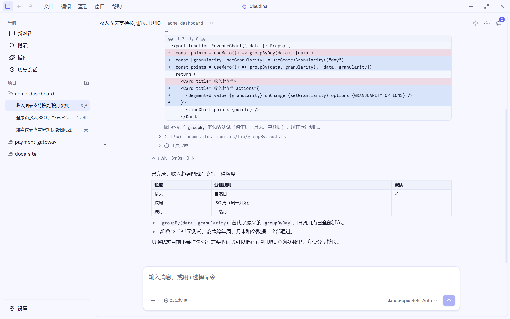

<h1 align="center">Claudinal</h1>

<p align="center">
  
</p>

<p align="center">
  一个为 Claude CLI 量身定制的高颜值桌面外壳。
</p>

<p align="center">
  <a href="https://github.com/ccpopy/claudinal/releases">
    
  </a>
  <a href="https://github.com/ccpopy/claudinal/blob/main/LICENSE">
    
  </a>
  
  
  
  
</p>

**核心理念：不重新发明 Agent，只打造一个比 TUI 更好用的桌面外壳。**
本项目通过 Tauri 2 封装本地 `claude` CLI 的 headless stream-json 接口，底层的 Prompt 处理、工具调度与 Hook 执行交由原生 Claude CLI 负责。桌面功能同时取决于所选 CLI 的公开协议、模型及账号支持；升级 CLI 后，可在运行环境诊断中检查能力依据和待确认状态。

## 特别感谢

<div align="center">

### [Linux.do](https://linux.do/)

**LinuxDo 社区**

真诚、友善、团结、专业，共建你我引以为荣之社区。

### [Trellis](https://github.com/mindfold-ai/trellis)

**The best agent harness**

让团队规模的 AI 编码更可靠：围绕渐进式规范、任务上下文、自定义工作流和跨 Agent 记忆构建的 Agent harness。

</div>

## 界面预览

### 主界面

<p align="center">
  
</p>

## ✨ 核心特性

- **极致的流式渲染**：沉浸式的 Markdown 对话体验，逐字渲染，平滑过渡。
- **Codex 风格会话管理**：清晰的本地项目分组、历史对话恢复、置顶、归档、删除与 SQLite 元数据缓存。
- **参数可视化控制**：在 Composer 中调节 Model / Effort / Permission Mode，并按会话保存偏好。
- **结构化消息卡片**：告别杂乱的终端输出，思考过程 (Thinking)、工具调用 (Bash/Edit/Read) 均采用独立、优雅的折叠卡片与 Diff 视图展示。
- **原生能力加持**：无缝支持系统文件拖拽粘贴、本地代理设置及深浅色主题自由切换。

### 0.6.4 Windows 电脑使用

- 在「设置 → 电脑使用」安装或选择 CuaDriver，再按对话开启、逐个授权应用窗口。授权仅在当前会话有效，可单独收回应用或立即收回全部控制。
- 支持窗口截图、原生/WinForms 窗口的左键、右键和左键双击，以及受权限限制的输入、按键、滚动和等待。浏览器及交易软件仅可查看，终端和 IDE 仅可查看和点击；不支持的后台操作会明确拒绝。
- 停止、断连和关闭会话会撤销访问并清理执行进程；驱动权限到期前自动轮换，截图和操作限定在获批窗口。
- 截图可在工具结果中展示，并传递给支持图像的上游。驱动就绪不代表模型已具备图像理解能力，真实账号和模型联调仍待验证。

### 0.6.1 Ultra / Fast 调整

- 根据实际选中 CLI 的隔离元数据检测控制能力，版本仅作兼容提示；新会话、历史会话和断连视图均可预选 Ultra / Fast。
- Ultra 提供会话级 Dynamic workflows 开关，保留当前 Effort；热更新按顺序确认，避免迟到响应覆盖新选择。
- Fast 分别显示已选择、实际状态和拒绝原因；Anthropic 兼容提供商可显式透传，最终生效仍取决于上游及账号资格。

### 0.6.0 能力范围

- 本地文件引用保留来源及行列信息；斜杠指令区分本地操作、终端入口与会话指令，未确认的命令保留原文。
- 提交尝试保存当次配置，提供显式的当前配置重试；权限由 CLI 判定，审查准备具有独立的限额、取消与降级状态。长历史的折叠内容按需挂载，保留展开和滚动位置。
- 检查点回退、完整子智能体事件、Fast、提示建议及上下文摘要仅按已确认的公开合约接入。Fast 和提示建议默认关闭；缺少账号或真实会话认证时会标明待验证，上下文窗口未知时不显示推算比例。
- 外部后台任务查询保持禁用：公开任务列表无法证明提供商、凭据及代理生命周期隔离。诊断提供 `claude agents --json --all` 和 `claude logs <id>` 供手动检查；`--bg` 与 `-p/--print` 不兼容。
- Agent Teams 保留既有实验开关，尚未认证完整的 headless 任务板与队友控制；resume/rewind 不会恢复进程内队友。Remote Control、官方听写及官方云执行不在本版范围内。

## 🛠️ 技术栈

- **外壳与后端**：Tauri 2 + Rust (子进程管理 + jsonl 读取 + SQLite 元数据缓存)
- **前端界面**：React 19 + TypeScript + useReducer
- **UI 框架**：shadcn/ui + Tailwind CSS v4 + lucide-react

## 🚀 快速开始

### 前置要求

1. 本地已安装并配置好官方的 `claude` CLI（≥ 2.1.123）。
2. Node.js 及 `pnpm` 包管理器。
3. Rust 编译环境。

### 本地运行

```bash
# 克隆仓库
git clone https://github.com/ccpopy/claudinal.git
cd claudinal

# 安装依赖
pnpm install

# 启动开发环境
pnpm tauri dev
```

### 打包构建

```bash
# 各平台打包 (自动检测当前系统)
pnpm tauri build

# --- Windows ---
pnpm package:exe          # NSIS 安装包 (.exe)
pnpm package:msi          # MSI 安装包
pnpm package:win          # 同时打包 NSIS + MSI

# --- macOS ---
pnpm package:dmg          # DMG 镜像
pnpm package:mac-app      # .app 包
pnpm package:mac          # .app + DMG
pnpm package:mac-universal # Universal Binary (.app + DMG)

# --- Linux ---
pnpm package:deb          # Debian/Ubuntu (.deb)
pnpm package:rpm          # RedHat/Fedora (.rpm)
pnpm package:appimage     # AppImage 便携包
pnpm package:linux        # 同时打包 deb + rpm + AppImage

# 从当前平台的 Tauri 构建产物生成 zip
pnpm package:portable      # 构建当前平台便携程序，再生成 zip
pnpm package:zip           # Windows：已有 NSIS 安装器 + 主程序生成两个 zip
pnpm package:zip-installer # Windows：仅已有 NSIS 安装器生成 zip
pnpm package:zip-portable  # 仅已有当前平台主程序生成便携 zip
```

zip 脚本使用 Cargo metadata 返回的有效 target 目录。安装器必须匹配当前 `productName`、版本和 Tauri 架构文件名；没有匹配或存在多个架构时会失败，不会选用共享缓存中的旧版或其他产品。便携程序须由 `tauri build` 产出，裸 `cargo build --release` 不能替代。交付前需校验 zip 内程序与本次构建程序的大小及 SHA-256；便携包只含程序和说明，仍需安装并配置官方 Claude CLI。

便携程序的 Claudinal 配置与缓存保存在同级 `.claudinal/`；Claude CLI 的配置仍由 CLI 管理，会话 JSONL 和 Claudinal sidecar 位于用户目录的 `~/.claude/projects/`。移动程序及其 `.claudinal/` 不会同时搬移会话文件。

### 自动发布

本地构建和 zip 打包只准备产物。完成质量检查、版本一致性及产物校验后，推送和版本号一致的 tag 才会触发公开 GitHub Release：

```bash
git tag v0.6.4
git push origin v0.6.4
```

Workflow 会校验 `package.json` 与 `src-tauri/tauri.conf.json` 的版本号，然后在 Windows、macOS 和 Linux runner 上分别构建安装包，并上传源码包与 `SHA256SUMS.txt`。

## 📜 协议

本项目采用 **GNU AGPLv3** 开源协议。

- 个人、学术及商业使用均免费。
- 修改或衍生作品必须以 AGPLv3 协议开源。
- 网络部署须向用户提供完整源码。
- 禁止在闭源商业产品中嵌入本项目代码。
